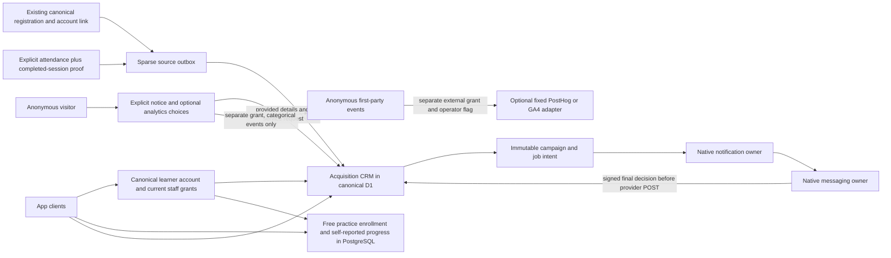

# Backend release audit — 16 October 2026

**Release decision: Blocked.** The audited backend implements identity/session
foundation, acquisition CRM and a narrow free-course practice/progress workflow.
It does not implement the requested Phase 2–6 native webinar, full LMS,
marketplace booking, commercial/B2B or AI assistant product. Existing website
modules and static catalog references are separate owners; references do not
prove working app workflows. This document records current local source evidence,
not staging, vendor delivery, deployment or device acceptance.

## Scope and reproducibility

Audited `Microservices/techlyup-service`, reusable
`learning-service/packages/learning-postgres` and changed native
`notification-service/src/orchestration` / `messaging-service/src/transport`.
The product adapter has no commits yet: all files are untracked, so there is no
reviewed Git baseline or released artifact identity. The current hashes are in
[source-manifest.json](source-manifest.json). Read applicable backend `AGENTS.md`.
The universal contract was initially unavailable in the scoped source search.
The user subsequently supplied it and root saved
`Desktop/TechlyUp-App/00_UNIVERSAL_INSTRUCTIONS.md`; it has now been read and its
incremental, evidence, privacy, provider and production gates apply. This is no
longer a missing-file blocker. No install, remote migration, payment, outbound
communication or production deployment was run by this audit.

The host had 4.4 GiB available at initial inspection.
Native Prisma client generation and TypeScript compilation were local generated
artifacts, with no database connection. Dependencies were reused from the
existing owning repositories; `npm ci` was intentionally not run during a
watching local environment. Remote CI has not been executed by this audit.

## Readiness matrix

| Module / acceptance | Result | Current evidence and remaining condition |
|---|---|---|
| Phase 0 canonical identity and private app sessions | Pass — local | Full backend suite: password compatibility, hashed sessions, HttpOnly browser refresh, native transport, refresh races/replay, current grants and atomic audit rollback. Staging identity/secret renewal remains untested. |
| Phase 0 D1 and PostgreSQL migration safety | Pass — local | All 46 canonical website schema migrations plus additive 0047–0051 work in actual isolated workerd/D1. Restricted-role PostgreSQL journeys pass, including RLS, tenant scope, immutable migration checksums/order/locking and failed-SQL rollback. |
| Phase 1 consented acquisition and CRM | Pass — local | Capture, private search, email-only dedupe, no inferred account ownership, current owner/staff assignment checks, CAS pipeline/task changes, durable notifications, audit rollback, bounded CSV and contact-level campaign dedupe pass. |
| Canonical registration / attendance CRM projection | Pass — local | Proven canonical registration-account link only; attendance before completion is deferred; later sparse completion wakes it once; explicit attended/no-show proof and exact completed-session time are required. No historical attendance sweep. |
| Task reminders / event-driven CRM rules | Pass — local | Explicit due staff task versions run once; closed/revoked/raced versions fail; automation-created tasks cannot recursively trigger due rules. |
| Anonymous analytics and privacy suppression | Pass — local | No event before explicit grant, opaque hash-only visitor cookie, no PII event schema, separate external-sharing permission, GPC/DNT veto, withdrawal with app off, bounded expiry and uncertain-export no-retry. |
| Notification/messaging final CRM consent hook | Partial | Actual source hook and local cross-owner/loopback provider guard pass. Native owner source changes are uncommitted; deployed registered workloads, protected key mounts, renewed JWTs, templates/senders and real suppression behavior are not proven. Flags stay off. |
| Meta/Instagram, LinkedIn, external-form live integrations | Blocked | Product has an approved signed normalization-relay contract. No approved real provider subscription or downstream normalization deployment was exercised. Raw vendor APIs/signatures belong to their owning integration/webhook service. |
| Phase 2 native LiveKit / Stream webinar platform | Blocked | No LiveKit/Stream adapter, room/access API, real-time moderator/poll/Q&A services or signed media pipeline in this product backend. Canonical registration/attendance schema references are not these features. |
| Phase 3 complete LMS | Partial | One published free text/practice course has account-owned enrollment and self-reported progress. No full course CMS, restricted video entitlement, question bank, quiz/assignment grading or verified certificate issuance in this adapter. |
| Phase 4 mentor marketplace | Blocked | Public mentor snapshot/enquiry category only. No approved application/evidence workflow, concurrency-safe holds/bookings, private consultation/notes or earnings workflow in this adapter. |
| Phase 5 commercial / membership / B2B | Blocked | No app order/payment/refund ledger, webhook fulfillment, central entitlement or isolated organization seat/invitation implementation. No charge performed. Existing website/common commerce modules were not counted as accepted app integration. |
| Phase 6 AI / RAG / mobile sync ecosystem | Partial | Free-course progress sync exists through PostgreSQL. No authorized-content AI retrieval/generation service, citation evaluation, model usage/cost enforcement or offline replay protocol in this adapter. Native installed builds, push and store acceptance require separate evidence. |
| Staging migrations and rollback / backup restore drill | Not Tested here | This audit used disposable local stores only. Do not substitute local rollback tests for a verified remote backup, restore receipt, migration review or staging E2E. |
| Attendee/media, queue fan-out, payment replay and AI budget capacity | Not Tested | Bounded CRM local load measured below. No stream cost or production throughput extrapolation. |

A local pass applies only to the named tested behavior. It is not a claim that
an entire phase is production-ready.

## Data flow and authority boundaries



`learner_accounts` and current ERP grants remain identity/role authority; no
additional password realm is created. CRM account association requires explicit
canonical proof. Email equality and anonymous events never infer identity.
PostgreSQL account references are external subjects, not authentication or paid
access grants. Commercial customers remain with Customer Service. Native
notification intents and the Cloudflare edge `/v1/notification` runtime have
different contracts and credentials.

Requested continuations from progress to certificate, mentor booking, invoice,
payment, entitlements, organization dashboard and AI are absent in this adapter;
therefore the diagram does not imply those edges function. Their future
implementation must call existing identity/entitlement owners and preserve the
canonical registration/data/URL contracts.

## Actual executed checks

Exact current working directories, commands, counts and scope are retained in
[commands-and-results.json](commands-and-results.json). Selected commands:

```sh
# techlyup-service
npm run typecheck
npm test
npm run test:native-bridge
node_modules/.bin/tsx --test docs/release-audit-2026-10-16/backend-negative.test.ts
npm audit --audit-level=high --json
node_modules/.bin/tsx docs/release-audit-2026-10-16/loopback-crm-load.mts

# techlyup-service/apps/api
../../node_modules/.bin/wrangler deploy --config wrangler.ci.jsonc --dry-run --outdir dist

# learning-service
npm run typecheck
npm test

# messaging-service: local generated client; no DB access
node_modules/.bin/prisma generate --no-hints
node_modules/.bin/tsc
node --experimental-vm-modules node_modules/jest/bin/jest.js --selectProjects unit --runInBand
```

Final backend run: **73/73 passed, zero skips**, 69.50 seconds. Learning package:
**9/9 passed**. Native cross-owner acceptance: **2/2 passed**. Additional backend
negative access/security audit: **2/2 passed**. Messaging full unit suite:
**57/57 passed**, including four new delivery-authority regressions.
Notification strict orchestration dependency-closure typecheck and three new
focused unit tests passed using existing sibling dependencies; the entire
notification package install/build/integration suite was not run. Do not sum
these counts as disjoint feature coverage.

Backend dependency audit: **0 vulnerabilities** across 118 installed dependencies
([raw npm audit result](backend-dependency-audit.json)). This is not a code
security review or the client dependency result. Read-only `npm audit --json`
also returned exit 0 / zero advisories for learning (50 dependencies) and both
native legacy npm snapshots. Learning's npm root manifest matches its lock.
Messaging and Notification declare pnpm 11.22.0; their older npm locks have 25 and
17 direct-dependency differences respectively, so those npm results are **Partial**
and cannot establish the active graph's safety. Separate
`COREPACK_ENABLE_NETWORK=0 pnpm audit --json` scans returned exit 0 / zero
advisories for the current messaging (880 total dependencies) and notification
(959) pnpm lock graphs. Their root pnpm dependency specifiers match the current
manifests. These checks neither repair dependencies nor prove runtime safety;
they remain separate from product/client scans. See
[lock compatibility](dependency-lock-compatibility.json) and the per-owner JSON
receipts in this folder. API-only package dry run passed:
**1174.98 KiB / 209.22 KiB gzip**. It did not deploy or package the mobile app.

### Local capacity evidence

[Measured JSON](loopback-crm-load-result.json): macOS arm64, Node 24.20.0,
loopback workerd, SQLite-backed local D1, concurrency 10, 40 unique synthetic
contacts plus 10 exact idempotency replays and 10 fresh-key duplicate contacts.
All **60/60 requests returned 202**, with p50 **42.35 ms**, p95 **67.88 ms**,
p99/max **68.17 ms**. Final persisted state: 40 contacts, 40 leads, 50 command
receipts and 50 capture audits; zero communication jobs or verified permissions.
`PRAGMA foreign_key_check` returned zero violations and `quick_check` was `ok`.
SQL query counts were not instrumented; audit/receipt counts are not query counts.

This is a small warm local sample. It tests neither attendee spikes nor remote
D1/queue/provider/streaming/AI costs and establishes no production SLA or capacity.

## Concrete fixes made during audit

1. **High — incompatible native HMAC/hash encoding.** Messaging used literal
   backslash sequences for `\\n` and `\\0`; CRM verifies real newline/NUL bytes.
   Corrected the sender encoding. The cross-owner test now passes the actual CRM
   handler/D1 and real native provider adapter through instrumented final guards.
2. **High — acquisition digest loses authority provenance.** Digests previously
   retained only a bucket ID, allowing the final lead consent callback to be
   omitted. Acquisition digest configuration is rejected, recipient digest
   preference suppresses the attempt, old frozen digests fail closed and frozen
   normal requests must retain exact canonical intent provenance. Unrelated
   notification digests retain existing behavior.

The local synthetic gateway sees one POST when authorized. Withdrawal, recipient
swap, decision expiry, authority outage, forged signature and replay produce zero
additional POSTs. This proves local control flow, not real message delivery.

## Unresolved risk / owner / remediation

| Severity | Risk | Owner | Required next evidence |
|---|---|---|---|
| Critical launch gate | Phase 2–6 requested workflows absent or only narrow foundations | Product and domain leads | Implement each functional workflow with cross-owner entitlement, audit and provider acceptance before advertising it. |
| High | No reviewed committed backend/native integration release identity | Engineering/release | Review and commit each independent repository, pin compatible versions, run their own CI and retain artifact hashes. |
| High | Native final-authority configuration not deployed or tested with real owner authentication | Messaging/Notification/Security | Mount separate protected key, register exact workloads/types/routes, prove rotation/expiry and unsubscribe immediately before provider dispatch using safe recipients. Keep sending off. |
| High | Staging schema/backup/restore and whole journey not accepted | DBA/SRE | Approved isolated staging target, current backup/recovery point, duplicate/null/FK preflight, apply reviewed migration chain, restore rehearsal and staging E2E receipt. |
| High | Full data export/deletion workflow and retention policy unresolved | Privacy owner/legal | Scope account/contact/legal-hold deletion across D1/PG/provider exports, authorize subject verification, audit and suppression retention; execute erasure/export tests. |
| High | Minors, guardian authority and age-related product decisions unspecified | Business/legal/safety | Explicit audience and guardian rules, age-appropriate notices and enforcement acceptance before relevant onboarding. |
| High | Webinar recording/media and certificate claims unimplemented in app | Webinar/LMS/legal | Notice and lawful-basis decision, signed access/revocation, actual participation/completion evidence, retention and certificate revocation verification. |
| High | Real payment/refund ledger, fulfillment and entitlements unimplemented | Commerce/finance/security | Sandbox success/failure/replay/out-of-order/refund acceptance; explicit production activation approval. |
| Medium | Anonymous third-party export deletion obligations not accepted | Privacy/analytics | Provider retention/region review, subject-choice controls and documented external-deletion handling. Uncertain HTTP export is not ingestion proof. |
| Medium | Operational capacity, alerts and recovery not exercised | SRE/domain owners | Remote representative bounded load, queue/DB budgets, dashboard/alert verification, incident drills and 30-day operating ownership. |
| Medium | Native services retain stale npm lockfiles beside current pnpm locks, making the wrong audit/install graph appear authoritative | Messaging/Notification/release | Use each declared pnpm manager and current lock in owner CI; review whether to remove or deliberately regenerate legacy npm locks outside this freeze. Current pnpm advisory scans pass, but npm snapshots alone are insufficient. |
| Medium | Local disk pressure can distort performance/build reliability | Workspace operator | Recover adequate capacity before repeated builds/load; rerun only after changes or failed checks justify it. |

## Release / rollback rules

Keep all committed app, learning, shared platform, CRM sending/integration and
external analytics flags off until each owned activation gate passes. Record
source commit and migration checksum, target Worker/D1/Hyperdrive identity,
backups/recovery point, secret ownership/rotation, rollout cohort and accountable
operator. Do not infer provider readiness from a boolean approval flag.

Rollback first disables optional capture/sending/export/rules and routes traffic
to the previously accepted Worker version. Reconcile durable queued, accepted and
uncertain jobs with their native owners; never blind replay or send through a
fallback. Additive schema may remain while data is preserved. A schema rollback
requires an approved backup restore/forward-fix plan, not automatic DROP statements.
Source migrations intentionally contain no destructive down migration.

Local audit rollback tests prove transaction atomicity. They do not prove remote
backup validity, full restore, RPO/RTO, vendor cancellation or deployed recovery.
